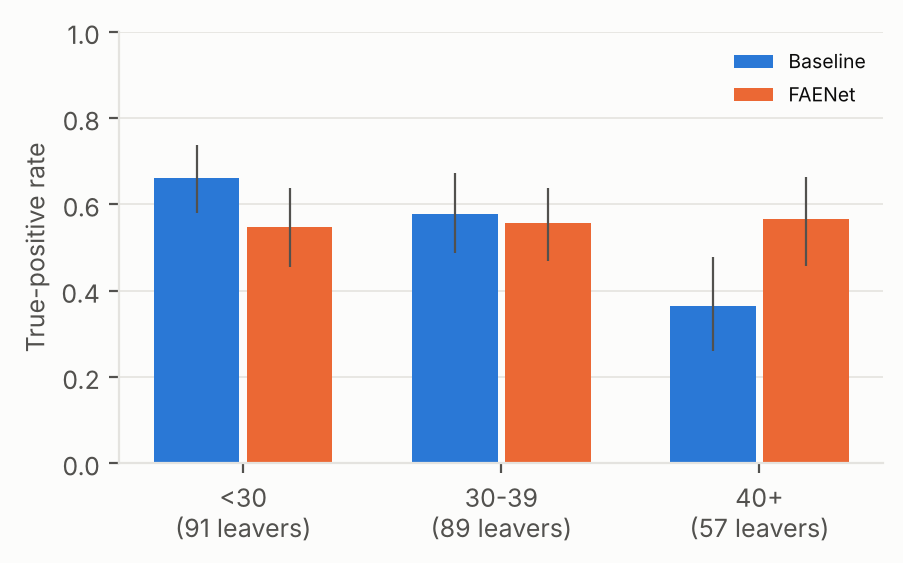
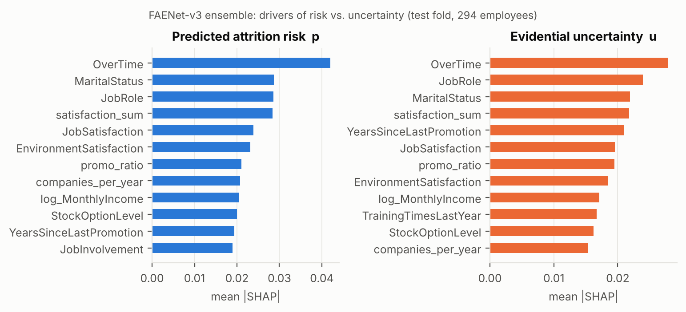
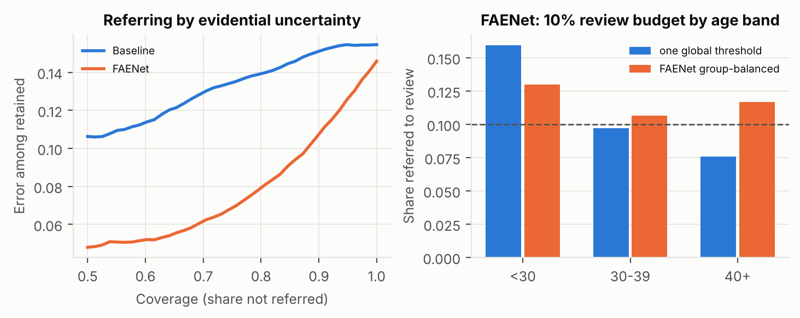

# FAENet: Fairness-Aware Evidential Neural Network for Employee Attrition Prediction

FAENet predicts which employees are likely to leave and adds three things a plain classifier does not provide:

- **Evidence and uncertainty.** An ensemble of evidential neural networks outputs Dirichlet evidence for *stay* and *leave*. That gives an attrition probability `p = α₁/S` and an uncertainty score `u = 2/S` for every employee.
- **Fairness.** A differentiable equal-opportunity penalty and age-aware decision thresholds keep leaver detection similar across age and gender groups. Age and gender are **never** model inputs.
- **Human review.** The most uncertain predictions are referred to HR reviewers, with group-balanced review thresholds. SHAP explains both the risk and the uncertainty.

**Authors:** Lakshya Varshney (2310110513) and Akash Agarwal (2310110718), Department of Computer Science and Engineering
**Report:** [`report/FAENet_report.pdf`](report/FAENet_report.pdf)

---

## Results (IBM HR Analytics)

The protocol is 5×5 repeated stratified cross-validation, so every employee is scored once per repeat. Values are means over repeats, with Δ given as a 95% paired, employee-level bootstrap CI.

| Metric | Baseline (single evidential net) | **FAENet** | Δ [95% CI] |
|---|---|---|---|
| ROC-AUC | 0.814 | **0.827** | +0.013 [+0.004, +0.024] |
| PR-AUC | 0.575 | **0.604** | +0.029 [+0.006, +0.055] |
| Precision | 0.520 | **0.549** | +0.029 [+0.007, +0.052] |
| Brier score (calibrated) | 0.101 | **0.095** | −0.006 [−0.009, −0.003] |
| TPR, leavers aged 40+ ¹ | 0.365 | **0.565** | +0.200 [+0.137, +0.263] |
| Age-band TPR gap ¹ | 0.297 | **0.077** | −0.219 [−0.288, +0.004] |
| Error-detection AUROC of `u` | 0.612 | **0.790** | +0.178 [+0.144, +0.205] |
| Error after reviewing 10% | 0.149 | **0.105** | −0.044 [−0.054, −0.034] |

¹ FAENet with age-aware decision thresholds.

The full table is in [`results/metrics/baseline_vs_final.csv`](results/metrics/baseline_vs_final.csv), and every variant (SMOTE, Group DRO, soft-TPR penalty and more) is in [`results/metrics/summary.csv`](results/metrics/summary.csv).

<p align="center">
  
  
</p>
<p align="center"></p>

---

## Method

```
employee record (28 HR attributes + 9 engineered features; Age/Gender kept aside)
        │  impute · standardise · one-hot (fitted on training data only)
        ▼
5 cross-fitted evidential MLPs (32 → 16 → 2)
   loss = class-weighted EDL fit + annealed KL + λ_f · equal-opportunity penalty
        ▼
per member: e = softplus(z), α = e + 1, p = α₁/S, u = 2/S
ensemble:   mean p, mean u, disagreement Var(p)
        ├── decision: p ≥ t (global or age-aware threshold), Platt-calibrated risk
        ├── review:   u > τ_g (group-balanced, 10% budget)
        └── SHAP explanation of risk and uncertainty
```

| Component | Setting |
|---|---|
| Ensemble members | 5 (cross-fitted on inner folds) |
| Hidden layers | 32, 16 · ReLU · dropout 0.1 |
| Optimiser | AdamW, lr 1e-3, weight decay 1e-3, batch 64 |
| Class weights | (N / 2N_c)^0.5 |
| KL weight | 0.5, annealed over 10 epochs |
| Equal-opportunity penalty | λ_f = 30 (FAENet-Fair variant) |
| Review budget | 10% per age band |

All settings were selected on validation folds only; see [`configs/faenet.yaml`](configs/faenet.yaml) and [`results/selection/`](results/selection/).

---

## Repository structure

```
FAENet/
├── faenet/                     # Python package
│   ├── data.py                 # IBM dataset loading, fairness groups (age band, gender)
│   ├── preprocessing.py        # imputation, scaling, one-hot encoding
│   ├── model.py                # evidential MLP (evidence, alpha, p, u)
│   ├── evidential_loss.py      # EDL fit loss, KL regulariser, annealing
│   ├── core.py                 # CV splits, features, SMOTE, Group DRO, fairness penalty,
│   │                           # cross-fitted ensemble, learned review head
│   ├── evaluation.py           # pooled out-of-fold metrics, paired bootstrap
│   ├── calibration.py          # Platt scaling
│   ├── metrics.py              # ECE, coverage-risk, group metrics
│   └── plotting.py             # figure style
├── scripts/                    # pipeline, run in order
│   ├── 00_eda.py               # dataset summary and group attrition rates
│   ├── 01_select.py            # hyperparameter / augmentation / fairness selection (validation only)
│   ├── 02_run_cv.py            # all variants on 25 CV splits -> results/predictions/
│   ├── 03_evaluate.py          # metrics + paired bootstrap -> results/metrics/
│   ├── 04_compare_baseline.py  # baseline vs FAENet table and figures
│   ├── 05_unseen_groups.py     # uncertainty on held-out departments / job roles
│   ├── 06_shap.py              # SHAP for risk and uncertainty
│   └── 07_lr_reference.py      # logistic regression reference on the same splits
├── configs/faenet.yaml         # final configuration
├── data/raw/                   # IBM HR Analytics CSV
├── results/                    # selection logs, per-split predictions, metrics, figures, SHAP
├── report/                     # IEEE-style report (LaTeX source + PDF)
├── notebooks/FAENet_colab.ipynb
├── tests/test_faenet.py
├── requirements.txt
└── CITATION.cff
```

---

## Quick start

```bash
git clone https://github.com/akashagarwal07/FAENet.git
cd FAENet
pip install -r requirements.txt
python -m pytest -q tests
```

### Reproduce the results

Per-split predictions are already in `results/predictions/`, so steps 3 to 6 run without retraining:

```bash
python scripts/03_evaluate.py          # ~13 min (500 bootstrap resamples)
python scripts/04_compare_baseline.py  # baseline vs FAENet table + figures
python scripts/05_unseen_groups.py
python scripts/06_shap.py
```

To retrain everything from scratch (about 45 minutes on a laptop CPU):

```bash
rm -rf results/selection results/predictions
python scripts/01_select.py --stage base
python scripts/01_select.py --stage aug
python scripts/01_select.py --stage fair
python scripts/02_run_cv.py
python scripts/03_evaluate.py && python scripts/04_compare_baseline.py
```

For a fast smoke test, set `FAENET_BOOT=20` to use 20 bootstrap resamples instead of 500.

### Google Colab

Open [`notebooks/FAENet_colab.ipynb`](notebooks/FAENet_colab.ipynb) in Colab. It clones this repository and runs the pipeline.

### Build the report

```bash
cd report && latexmk -pdf main.tex
```

---

## Evaluation protocol

- 5 repeats × 5 stratified folds, stratified on attrition × gender × age band. In each split, 15% of employees form the validation set.
- Preprocessing, class weights and SMOTE are fitted on each training part only. Synthetic rows never enter validation or test data.
- Classification thresholds, Platt calibration, age-aware thresholds and review quantiles are fitted on validation predictions and frozen before the test fold is scored.
- Model comparisons are paired (same employees, same splits), with 500 employee-level bootstrap resamples.

## Citation

```bibtex
@misc{varshney2026faenet,
  title  = {FAENet: A Fairness-Aware Evidential Neural Network with Uncertainty-Based Human Review for Employee Attrition Prediction},
  author = {Varshney, Lakshya and Agarwal, Akash},
  year   = {2026},
  howpublished = {\url{https://github.com/akashagarwal07/FAENet}}
}
```

## Data

IBM HR Analytics Employee Attrition & Performance:
https://www.kaggle.com/datasets/pavansubhasht/ibm-hr-analytics-attrition-dataset
